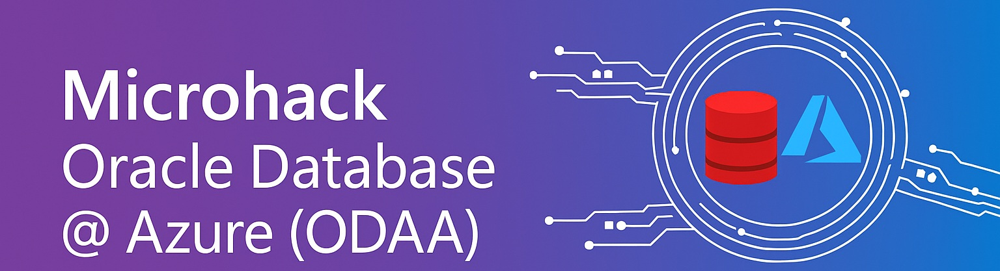
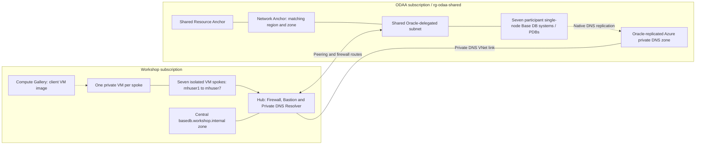

## Workshop overview

This introductory microhack gives you hands-on experience with Oracle Base
Database Service on Oracle Database@Azure (ODAA). You create a single-node
DB system and a pluggable database (PDB), connect from a prepared Azure VM,
inspect centrally managed private networking and DNS, and validate SQL
connectivity and latency.

You select the Base Database system shape, storage, database edition and software
version, provide an SSH public key, and manage database users.

> [!IMPORTANT]
> The target is Oracle 26ai in France Central, Enterprise Edition, License
> Included, and one node per participant (no RAC). Start with `VM.BaseDB.x86`,
> 4 ECPUs, 256 GB of data storage and database version `26.0.0.0.0`.
> This is the minimum configuration within the approved edition and license.
> Validate one database before provisioning the remaining six. Regional
> quota, capacity, pricing and zone mapping must still be checked before deploying.
> Native replicated DNS and encrypted PDB SQL have been verified from User1
> through Bastion/SSH, including the canonical SYSTEM SQL probe.
> All seven participant paths remain
> pending; `WORKSHOP_PHASE_B_READY` stays `false`.
> Organizer Entra SSH and sudo through Bastion now pass on VM 1.
> Administrator Login is assigned on all seven participant resource groups;
> VMs 2-7 are deallocated, so their live SSH checks remain pending.
> Participant-account sign-in still needs separate live acceptance.
> Oracle-to-Azure name resolution is a separate, currently unconfigured direction.
> Do not substitute another version or shape without the organizer's approval.

## Architecture

The hub and all seven client spokes share one workshop subscription. Oracle
resources use a separate ODAA subscription. The prepared VM
represents an application or simulated on-premises client. Each participant has
a separate client VNet. Independent Bicep deployments prepare the hub, spokes
and shared ODAA VNet. There is no configurable participant count.
Network Anchors bridge the delegated Azure subnet and OCI networking.

Spoke custom DNS points to the firewall DNS proxy, which forwards to the hub
Private DNS Resolver. Oracle replicates its private DNS zone to Azure during
database creation. The organizer links that existing zone to the hub VNet;
database queries then resolve within Azure without an Oracle listening endpoint.
This does not configure Oracle-to-Azure DNS forwarding. Participants can inspect
hub settings and modify only their own Azure spoke. All seven participants use
the same Oracle resource group, `rg-odaa-shared`, and can manage all BaseDB
systems there. Shared Oracle networking and anchors remain read-only except
for security-rule edits on the tagged workshop OCI NSG. Participants add
only their own client SQL ingress rule in that shared group.

The [independent deployment guide](infra/deployments/README.md) separates
Azure-only preparation from the Oracle-dependent steps.
GitHub workflows use [new-tenant OIDC](infra/deployments/README.md#github-oidc-bootstrap)
and hosted runners. Private tests execute on a participant VM through Azure
Managed Run Command, without Terraform state or an internal GitHub runner.

Peering alone does not grant database access. You also need OCI security rules,
working private DNS, an open PDB with a registered service, and a database user.
The native Oracle hostname identifies the DB node; it does not replace the PDB service name.

## Challenges

> [!WARNING]
> **User2 is only an example in every guide.** The screenshots use User2.
> Replace `mhuser2`, `vm-mhuser2`, `rg-vm-mhuser2` and `basedb2` with your own assigned user
> number and resource names. Tenant, subscriptions, shared networking and PDB
> `WORKSHOP` stay the same.

### Challenge 0: Set up your account

Sign in, complete MFA, and verify your VM and ODAA resource-group access.

* [Account setup](walkthrough/setup-user-account/setup-user-account.md)

### Challenge 1: Understand the ODAA subscription

Review the marketplace subscription, resource providers and OCI tenancy link.
The organizer completes onboarding once for the shared ODAA subscription.
Participants inspect readiness without purchasing or changing the integration.

* [ODAA subscription](walkthrough/create-odaa-subscription/create-odaa-subscription.md)

### Challenge 2: Create a Base Database

Verify the delegated subnet and Resource Anchor, select the centrally assigned
Network Anchor, and provision a single-node DB system and PDB.

* [Create Base Database](walkthrough/create-odaa-basedb/create-odaa-basedb.md)

This challenge ends when the portal deployment starts. After provisioning,
you retrieve your own hostname, private IP and PDB connection string in the
following challenges.

### Challenge 3: Configure NSG rules

After the BaseDB deployment completes, inspect your VM's Azure security
rules without changing them. Open OCI from Azure and add one stateful
TCP `1521` ingress rule for your own client subnet.
Do not change Oracle defaults or other participants' rules in the shared group.

* [Configure NSG rules](walkthrough/configure-odaa-basedb-nsg/configure-odaa-basedb-nsg.md)

### Challenge 4: Verify private DNS

Find the database hostname, resolve it with `dig` from your VM through portal
Bastion, and inspect the replicated Azure private DNS zone and its hub link.

* [Base Database DNS](walkthrough/verify-odaa-basedb-dns/verify-odaa-basedb-dns.md)

Success means the assigned Oracle hostname resolves to the correct private IP
through the firewall and resolver.

### Challenge 5: Retrieve the PDB connection string and connect

Open OCI from the Azure portal, verify your database node and copy the
`WORKSHOP` PDB's Easy Connect string. Open your VM through portal Bastion
and connect as `SYSTEM` with SQL*Plus.

* [Base Database Easy Connect](walkthrough/connect-odaa-basedb/connect-odaa-basedb.md)

Success means you are connected to `WORKSHOP` and a SELECT returns `1`.

### Challenge 6: Measure database round trips

After network acceptance, use the existing `SYSTEM` administrator account and
measure with the prepared `ociping` and `connping` tools. Compare Oracle Net
round trips on a persistent connection with login and SQL timings on new
connections. No additional SQL user is created.

* [Base Database connectivity and performance](walkthrough/perf-test-odaa-basedb/perf-test-odaa-basedb.md)

Success means both tools run against your PDB and you can explain the
millisecond timings and summary statistics using the User2 examples.

## Using the walkthroughs

Follow the seven Markdown guides above in order. Create your database in the Azure portal;
connect to your VM through **Connect > Connect via Bastion** in the Azure
portal, and copy shell and SQL commands into that Bastion browser session.
Use `dig` for DNS resolution. No local terminal, Cloud Shell or Azure CLI
is needed for the participant challenges.

The prepared VM already contains `dig`, `nc`, SQL*Plus, `ociping`, `connping`
and Oracle Instant Client. Participants
run small shell and SQL commands, not Python blocks. SQL tests use the existing
`SYSTEM` login and prompt for its password without displaying it.
CI remains separate and uses Managed Run Command.

Participant databases are `basedb1` through `basedb7`; `basetest01` through
`basetest07` are reserved for CI. All use PDB `WORKSHOP`.
Private local files stay in the workspace's Git-ignored `.workshop-secrets/`.
Never put passwords into shell commands, shared output or Git.

## Repository map

| Path | Purpose |
|------|---------|
| [walkthrough/](walkthrough/) | Seven participant Markdown guides with portal steps and copyable shell commands |
| [infra/](infra/README.md) | Organizer setup, deployment and cleanup |
| [infra/deployments/](infra/deployments/README.md) | Canonical Bicep stages, static `.bicepparam` inputs, shared modules and template tests |
| [infra/identity/provision.ps1](infra/identity/provision.ps1) | Stateless Graph provisioning, read-only verification and explicit local credential resets |
| [infra/identity/tests/](infra/identity/tests/) | Identity safety regressions |
| [infra/packer/](infra/packer/README.md) | Packer HCL, canonical Ansible toolchain, image build helpers and offline tests |
| [.github/workflows/](.github/workflows/) | Hosted OIDC deployment, identity verification, image build, tests and cleanup |
| [tests/base_database.py](tests/base_database.py) | Shared live BaseDB lifecycle, actual endpoint discovery and OCI NSG reconciliation |
| [tests/export_shared_config.py](tests/export_shared_config.py) | Canonical ARM-output export and fixed workshop configuration |
| [tests/workshop_config.json](tests/workshop_config.json) | Seven participant assignments, DB names and desired OCI SQL ingress |
| [tests/bicep/base-db-test.bicep](tests/bicep/base-db-test.bicep) | Guarded DB creation template used by CI and organizer automation |
| [tests/network_probe.py](tests/network_probe.py) | Read-only topology, replicated DNS and network acceptance |
| [tests/hub_dns_diagnostic.py](tests/hub_dns_diagnostic.py) | Temporary private hub diagnostic VM lifecycle |
| [tests/sql_probe.py](tests/sql_probe.py), [tests/provision_sql_user.py](tests/provision_sql_user.py) | Thick-mode SQL probe and limited-user bootstrap for VM-based CI |
| [tests/run-tests.sh](tests/run-tests.sh), [tests/helpers/](tests/helpers/) and `tests/challenge-*.bats` | Live end-to-end acceptance suite executed on a private VM |
| `tests/test_*.py` | Offline orchestration, network, shell walkthrough and repository-layout regression tests |

### Required files versus optional entry points

The `tests/` directory is **not disposable test data**. Organizer automation uses
its orchestrator, configuration reader and topology checker. CI packages its
SQL/BATS helpers for the participant VM. Keep these shared files even when
you do not run the full end-to-end test workflow.

All Bicep modules under `infra/deployments/modules/` have active callers.
Keep the stage parameter files: they define the reviewed identities, network
settings and actual Oracle DNS zone. The Packer `.pkr.hcl` and `.pkrvars.hcl.example`
files also remain necessary; HCL is a file format, not proof of Terraform usage.
Packer builds the client image, Bicep deploys Azure resources, Graph provisions
identities, and the guarded OCI CLI action maintains the database NSG rules.

These files are retained for specific organizer tasks, not the normal participant path:

| Optional entry point | When it is needed |
|----------------------|-------------------|
| [infra/deployments/oracle-subscription.bicep](infra/deployments/oracle-subscription.bicep) | One-time organizer Marketplace/OracleSubscription onboarding |
| [infra/ansible/playbooks/oracle-tools.yml](infra/ansible/playbooks/oracle-tools.yml) | Manually apply the canonical toolchain to a separately reviewed VM inventory |
| [infra/packer/scripts/install-oracle-tools.sh](infra/packer/scripts/install-oracle-tools.sh) | Manually install that toolchain on a local Ubuntu machine; changes that machine |
| [infra/scripts/setup-github-federation.ps1](infra/scripts/setup-github-federation.ps1) | Bootstrap or update GitHub OIDC and its scoped workflow trusts |
| [infra/scripts/cleanup-base-database.ps1](infra/scripts/cleanup-base-database.ps1) | Explicitly reviewed, owner-filtered database cleanup |
| [infra/scripts/cleanup-packer-leftovers.ps1](infra/scripts/cleanup-packer-leftovers.ps1) | Recover temporary image-build resources after a failed Packer run |

The root logo, license, code of conduct, security policy, issue templates and
CODEOWNERS are repository/documentation assets, not cloud deployment inputs.
Local credentials and generated files are described in the
[organizer cleanup notes](infra/README.md#local-files-and-retired-terraform).
Before reusing participant accounts, follow the organizer
[password and MFA reset procedure](infra/identity/README.md#reset-passwords-and-mfa-before-a-workshop).
It saves a private local JSON export; CI never publishes participant passwords.

### Why Terraform still appears in ignore rules

No active workflow or deployment requires Terraform. The root
[.gitignore](.gitignore) deliberately still excludes legacy Terraform state,
variables, plans and provider caches because they can contain credentials.
Those are safety rules, not Terraform settings or an instruction to run it.
The duplicate infrastructure ignore file and its old `terraform.tfvars`
workflow-trigger exception have been removed.
Some regression tests still mention Terraform fixtures or retired fallback
variables deliberately; they do not execute Terraform.

Retired Terraform sources, outdated research notes and unreferenced screenshots
are not alternate deployment paths.
Use Git history for those sources. Local Terraform leftovers are kept in a
private archive outside the checkout, never imported into the current lab.

## Operating and migrating the workshop

Read the [organizer guide](infra/README.md) before running workflows. Deployments
incur cloud charges; cleanup deletes resources.

This environment uses the new tenant, two target subscriptions and exactly
seven participants. Old tenant IDs, identity object IDs and Terraform states
are not imported into it. Build the reviewed image version `1.1.0` and validate
the complete lifecycle before inviting participants.

The repository contains only the current Base Database setup. Historical
Terraform deployments, internal-runner infrastructure and AKS extension
exercises were removed; use Git history if you need to inspect them. Removing
their source files does not delete Azure resources, local Terraform state or
organizer credentials.

## References

* [Create Oracle Base Database@Azure](https://docs.oracle.com/en-us/iaas/Content/database-at-azure/azucr-create-base-database.html)
* [Network Anchor design](https://docs.oracle.com/en-us/iaas/Content/database-at-azure/network-anchor-design.htm)
* [Azure regional availability](https://learn.microsoft.com/azure/oracle/oracle-db/oracle-database-regions)
