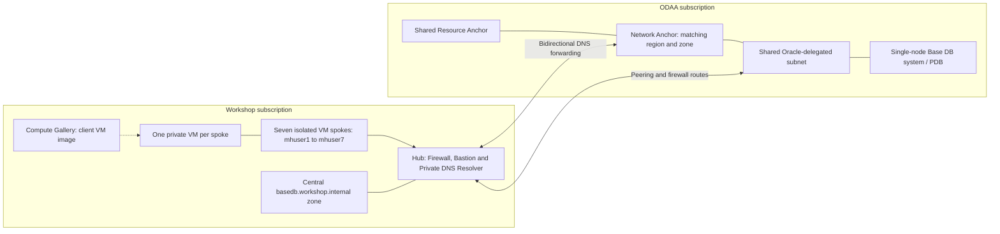

## Workshop overview

This introductory microhack gives you hands-on experience with Oracle Base
Database Service on Oracle Database@Azure (ODAA). You create a single-node
DB system and a pluggable database (PDB), connect from a prepared Azure VM,
inspect centrally managed private networking and DNS, and validate SQL
connectivity and latency.

Base Database is not Autonomous Database (ADB). You select the DB system shape,
storage, database edition and software version, provide an SSH public key, and
manage database users. ADB settings such as `_high` services, ADB wallets,
2 ECPUs/20 GB, and `adbping` do not apply to this workshop.

> [!IMPORTANT]
> The target is Oracle 26ai in France Central, Enterprise Edition, License
> Included, and one node per participant (no RAC). Regional version/shape
> availability, quota, pricing and zone mapping must be checked before deploying.
> The BaseDB lifecycle and bidirectional Oracle DNS have not yet been validated
> against the live Azure/OCI environment.
> Do not substitute another version or shape without the organizer's approval.

## Architecture

The hub and all seven client spokes share one workshop subscription. Oracle
resources use a separate ODAA subscription. The prepared VM
represents an application or simulated on-premises client. Each participant has
a separate client VNet. Independent Bicep deployments prepare the hub, spokes
and shared ODAA VNet. There is no configurable participant count.
Network Anchors bridge the delegated Azure subnet and OCI networking.

Spoke custom DNS points to the firewall DNS proxy, which forwards to the hub
Private DNS Resolver. After Oracle onboarding, the resolver forwards Oracle
domains to the Network Anchor listening endpoint. Oracle forwards the Azure
private zone back to the resolver inbound endpoint. Participants can inspect
hub settings but can modify only their own spoke and database resource groups.

The [independent deployment guide](infra/deployments/README.md) separates
Azure-only preparation from the Oracle-dependent steps.
GitHub workflows use [new-tenant OIDC](infra/deployments/README.md#github-oidc-bootstrap)
and hosted runners. Private tests execute on a participant VM through Azure
Managed Run Command, without Terraform state or an internal GitHub runner.

Peering alone does not grant database access. You also need OCI security rules,
working private DNS, an open PDB with a registered service, and a database user.
The native Oracle hostname identifies the DB node; it does not replace the PDB service name.

## Challenges

### Challenge 0: Set up your account

Sign in, complete MFA, and verify your VM and ODAA resource-group access.

* [Account setup](walkthrough/setup-user-account/setup-user-account.md)

### Challenge 1: Understand the ODAA subscription

Review the marketplace subscription, resource providers and OCI tenancy link.
The organizer completes onboarding once for the shared ODAA subscription.
Participants inspect it only after successful activation; this challenge is theoretical.

* [ODAA subscription](walkthrough/create-odaa-subscription/create-odaa-subscription.md)

### Challenge 2: Create a Base Database

Verify the delegated subnet and Resource Anchor, select the centrally assigned
Network Anchor, and provision a single-node DB system and PDB.

* [Create Base Database](walkthrough/create-odaa-basedb/create-odaa-basedb.md)

Success means the DB system and database are available, the PDB is open, and you
have recorded the node's private IP and actual PDB service name.

### Challenge 3: Configure network security and DNS

Inspect the firewall, resolver, Network Anchor DNS endpoints and your own spoke
security rules. Check name resolution and TCP connectivity without modifying
the central DNS zone or another participant's resources.

* [Base Database networking and DNS](walkthrough/update-odaa-basedb-nsg-dns/update-odaa-basedb-nsg-dns.md)

Success means the assigned Oracle hostname resolves to the correct private IP
through the firewall and resolver, and the listener is reachable on TCP 1521.

### Challenge 4: Connect to the PDB and measure latency

Use a PDB-local workshop account with SQL*Plus to execute SQL and measure repeated
round trips. A TCP-only check is not sufficient.

* [Base Database connectivity and performance](walkthrough/perf-test-odaa-basedb/perf-test-odaa-basedb.md)

Success means `SELECT` executes in the intended PDB and you can explain the
difference between DNS resolution, listener connectivity and SQL round-trip time.

## Repository map

| Path | Purpose |
|------|---------|
| [walkthrough/](walkthrough/) | Participant instructions |
| [infra/](infra/README.md) | Organizer setup, deployment and cleanup |
| [infra/deployments/](infra/deployments/README.md) | Independent Bicep hub, image gallery, spokes and Oracle networking deployments |
| [infra/identity/](infra/identity/README.md) | Stateless creation of the seven Entra ID users |
| [infra/packer/](infra/packer/README.md) | Packer/Ansible client image |
| [.github/workflows/](.github/workflows/) | Deployment, tests and cleanup |
| [tests/](tests/) | Isolated Base Database end-to-end tests |

## Operating and migrating the workshop

Read the [organizer guide](infra/README.md) before running workflows. Deployments
incur cloud charges; cleanup deletes resources.

Existing ADBs are not converted into Base Database systems. Data migration, if
needed, is a separate task. Remove old workshop ADBs through an explicitly
reviewed legacy cleanup before switching environments. Base Database cleanup
must not be treated as cleanup of those legacy ADBs.

This environment uses the new tenant, two target subscriptions and exactly
seven participants. Old tenant IDs, identity object IDs and Terraform states
are not imported into it. Build the reviewed image version `1.1.0` and validate
the complete lifecycle before inviting participants. The old monolithic
Terraform roots are historical references, not the active deployment path.

Older ADB-specific extension exercises (for example ADB high availability,
Fabric or ADB Entra SSO) are not part of this Base Database workshop and have
not been converted into Base Database solutions.

## References

* [Create Oracle Base Database@Azure](https://docs.oracle.com/en-us/iaas/Content/database-at-azure/azucr-create-base-database.html)
* [Network Anchor design](https://docs.oracle.com/en-us/iaas/Content/database-at-azure/network-anchor-design.htm)
* [Azure regional availability](https://learn.microsoft.com/azure/oracle/oracle-db/oracle-database-regions)
