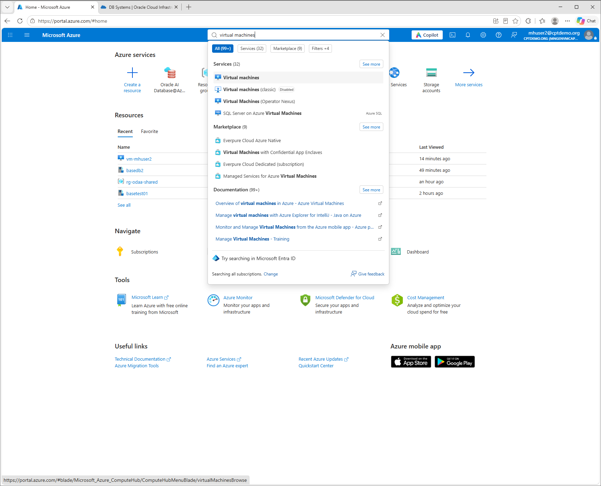

## Challenge 3: Configure NSG rules

[Workshop overview](../../README.md)

> [!WARNING]
> **User2 is only an example.** Replace `mhuser2`, `vm-mhuser2`,
> `rg-vm-mhuser2` and `basedb2` with your own assigned user
> number and resource names. Tenant, subscriptions, shared networking and PDB
> `WORKSHOP` stay the same.

A network security group (NSG) controls which network connections are allowed.
Azure and OCI have separate security groups. Inspect the Azure rules without
changing them. Then find your VM's subnet address range in Azure and use
that value to add one OCI ingress rule.

Start after [creating your BaseDB](../create-odaa-basedb/create-odaa-basedb.md).
Wait until its deployment has completed and the DB system is available before
opening OCI. You do not need a PDB connection string for this challenge.

> [!CAUTION]
> The OCI security group is shared. Your permission can also change other
> participants' rules and Oracle's default rules in this group.
> Add only your own TCP `1521` rule. Do not edit or delete existing rules,
> change the Azure rules, or detach the security group.

## Step 1: Open your VM's Azure security group

1. Open the [Azure portal](https://portal.azure.com/).
2. Search for **Virtual machines**.

3. Select your own VM, for example `vm-mhuser2` in `rg-vm-mhuser2`.

4. Open **Networking > Network settings**.


5. Follow the network security group link. The workshop group is named
   `nsg-vm-mhuser2` for User2.

5. Open **Inbound security rules**.


Inspect `AllowHubBastionSSH`:
   it allows SSH on port `22` from Bastion subnet `10.100.0.64/26`.
6. Inspect `DenyOtherClientsInbound`. It blocks connections from the other
   client networks.

This explains why you connect through portal Bastion rather than directly
from another participant VM.

## Step 2: Inspect Azure outbound rules

1. Open **Outbound security rules**.


2. Inspect `AllowFirewallDNS`: DNS traffic on port `53` goes to firewall
   `10.100.0.4`.
3. Inspect `DenyOtherDNS` and `DenyAzurePlatformDNS`. They prevent alternative
   DNS paths.
4. Inspect `DenyOtherClientsOutbound`. It isolates the client networks.
5. Note the rule priorities: smaller numbers are evaluated first.

An allowed connection still needs a working route and firewall rules.
You will check the DNS path with `dig` in the next
[DNS challenge](../verify-odaa-basedb-dns/verify-odaa-basedb-dns.md).

## Step 3: Find your VM subnet CIDR in Azure

A virtual network (VNet) contains subnets. Your VM has a private IP address
inside one of these subnets. A **CIDR** describes the address range of a
network or subnet, for example `10.0.2.0/24`. The `/24` is part of the value
and describes the size of the range. Copy it together with the address.

### Find your VM

1. Return to the [Azure portal](https://portal.azure.com/) browser tab.
2. Click the search bar at the top of the portal.
3. Type `Virtual machines` and select the **Virtual machines** service.
4. In the VM list, find your own VM. For User2, its name is `vm-mhuser2`.
5. Click the VM name to open it.
6. On **Overview**, check that **Resource group** is your assigned group,
   for example `rg-vm-mhuser2`.


### Find the network and subnet used by your VM

1. In the VM's left menu, expand **Networking**.
2. Click **Network settings**. The full menu path is
   **Networking > Network settings**.


3. Find **Virtual network / subnet** in the network interface details.


4. Write down both names shown there. For User2:

   | Item            | Name for User2     |
   |-----------------|--------------------|
   | Virtual network | `vnet-vm-mhuser2`  |
   | Subnet          | `snet-vm-mhuser2`  |

These are the network and subnet of the client VM. Do not use
`vnet-odaa-shared`, which is the database network.

### Open that subnet in Azure

1. Click the portal search bar at the top again.
2. Type `Virtual networks` and select the **Virtual networks** service.


3. Find the VNet name you wrote down, for example `vnet-vm-mhuser2`.


4. Click that VNet name.


5. In its left menu, expand **Settings** and click **Subnets**.
   The full menu path is **Settings > Subnets**.


6. In the subnet table, find the subnet name you wrote down, for example
   `snet-vm-mhuser2`.


### Copy the subnet address range

1. In that subnet's row, look at the **IPv4 address range** column.


2. Copy the complete value, including the slash and the number after it.
   For User2, copy:

   ```text
   10.0.2.0/24
   ```

3. Keep this value in your notes as **My client subnet CIDR**.
4. In Step 5 below, paste this exact value into the OCI rule's
   **Source CIDR** field.

You do not need to calculate the CIDR yourself. Copy the value Azure shows
for your own subnet. Do not edit or save any Azure network settings.

Do not copy the VM's single private IP address. This exercise allows the
client subnet, not just one IP. Use the subnet attached to your own VM,
not the address space of an unrelated VNet.

### Why this CIDR belongs in the OCI rule

The database connection follows this path:

```text
Your VM in Azure -> hub firewall -> BaseDB private IP, TCP 1521
```

The VM starts the connection. In the OCI rule, **Source CIDR** therefore
means the subnet containing that VM. **Ingress** means traffic arriving
at the database, and **Destination port** is the database listener's port.

For User2, enter `10.0.2.0/24` because `vm-mhuser2` belongs to that subnet.
Do not enter:

* `192.168.0.0/24`, which contains the database, not the client VM.
* `10.100.0.64/26`, which contains Bastion. Bastion opens your VM shell;
  SQL*Plus on the VM makes the database connection.
* `0.0.0.0/0` or `10.0.0.0/8`, which would allow a much broader source range.

Other participants must use the subnet found on their own VM, not User2's
example value.

## Step 4: Open the database's OCI security group

1. In the Azure portal, open **Oracle AI Database@Azure**.
2. Select **Oracle Base Database Service** and open your DB system,
   for example `basedb2`.
3. On **Overview**, select **Go to OCI**.

4. Sign in through **Microsoft Entra ID - CPTDEMO Workshop**, using tenancy
   `cptdemo`, domain **Default**, and your assigned workshop account.
5. On the DB system page, open **DB system information**.


6. In the networking details, find **Network security groups**.

7. Open the group attached to this DB system. 

8. Open **Security rules**.


### OCI NSG Rules explained

**Ingress** means traffic arriving at the database's network interface.

The group contains these existing rules:

| Rule                              | Meaning |
|-----------------------------------|---------|
| Ingress from `192.168.0.0/16`, TCP  | Allows TCP traffic with a source address in the Azure VNet `vnet-odaa-shared`; no destination port restriction is configured in this rule. |
| Ingress from `192.168.0.0/16`, ICMP | Allows ICMP traffic with a source address in that Azure VNet's address range. |
| Ingress from the same NSG          | Allows traffic between network interfaces that belong to this security group. |
| Egress to `0.0.0.0/0`              | Allows outbound traffic to any IPv4 destination, subject to routing and other network controls. It does not allow inbound internet access. |

`192.168.0.0/16` is the address space of the Azure VNet `vnet-odaa-shared`.
It contains `snet-odaa-delegated` (`192.168.0.0/24`), which is delegated to
`Oracle.Database/networkAttachments`. It is not a separate OCI-only address
range. The security rules are enforced in OCI, but their source CIDR refers
to this Azure VNet address space.

The rules cover the full `/16`, not only the delegated `/24`. They do not
create routes or bypass other network controls. Do not confuse them with the
seven client-subnet rules, which allow only TCP `1521`.
Leave the Oracle-managed rules unchanged.

### NSG OCI Access Rights

Your synchronized workshop group can view the network details and change
security rules on the approved shared workshop NSG. The organizer scopes the
rule-editing permission to that group using a defined resource tag.
It does not grant permission to create or delete NSGs, change their tags,
or attach and detach network interfaces.
The permission is shared-group access, not per-participant rule isolation.
Do not use organizer credentials.

## Step 5: Add your OCI NSG ingress rule

1. On the OCI NSG's **Security rules** tab, select **Add Rules**.


2. Enter the following values. For **Source CIDR**, paste the subnet address
   range you copied from Azure in Step 3, not an address from the OCI page.
   The table shows User2's example.

   | Field                  | Value for User2              |
   |------------------------|------------------------------|
   | Direction              | Ingress                      |
   | Stateless              | Leave unchecked (stateful)   |
   | Source type            | CIDR                         |
   | Source CIDR            | `10.0.2.0/24`                |
   | IP protocol            | TCP                          |
   | Source port range      | All (leave unrestricted)     |
   | Destination port range | `1521`                       |
   | Description            | `Participant mhuser2: SQL`   |

   Leave the source port unrestricted because the client chooses its own
   outgoing port. `1521` belongs in **Destination port range** only.
   Keeping **Stateless** unchecked allows response traffic for this connection.


3. Check that the source is your client subnet, not `192.168.0.0/24`,
   `0.0.0.0/0`, or the whole `10.0.0.0/8` range.
4. Select **Add Rules** to save.


## Step 6: Verify your saved rule

1. Find your new ingress rule in the list.
2. Compare **Source CIDR** with the subnet address range you copied from
   Azure in Step 3. They must match exactly, including `/24`.
3. Verify protocol **TCP**, destination port `1521`, and that the rule is stateful.
4. Leave the existing rules unchanged.

Azure security rules alone do not open the separate OCI security group.
Your new rule permits network access, but database credentials are still
required. You will test the connection in the Easy Connect challenge.

## Success criteria

* You can identify the Azure rules for Bastion SSH and firewall DNS.
* You found your own VM's subnet CIDR in the Azure portal and used it as the source.
* You created one stateful OCI ingress rule for your client subnet on TCP `1521`.
* You can distinguish network access from database authentication.
* You did not change Azure rules, Oracle defaults or other participants' rules.

Next: [Verify private DNS](../verify-odaa-basedb-dns/verify-odaa-basedb-dns.md).
