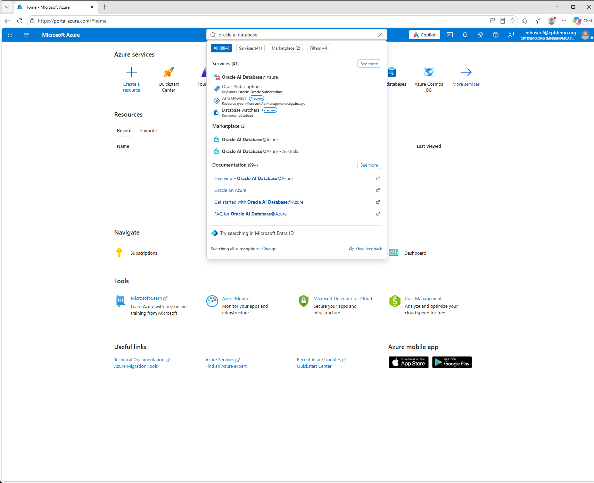

## Challenge 2: Create User2's Base Database

[Workshop overview](../../README.md)

> [!WARNING]
> **User2 is only an example.** Replace `mhuser2`, `vm-mhuser2`,
> `rg-vm-mhuser2` and `basedb2` with your own assigned user
> number and resource names. Tenant, subscriptions, shared networking and PDB
> `WORKSHOP` stay the same.

This example uses participant **User2** (`mhuser2@cptdemo.org`) and creates
**`basedb2`** using the prepared subscription, permissions and shared networking.
Creation takes place entirely in the Azure portal.

## Step 1: Open the Azure portal

1. Open [portal.azure.com](https://portal.azure.com/) in a private browser window.
2. Sign in as `mhuser2@cptdemo.org` and complete MFA if prompted.
3. If necessary, use the account menu to switch to directory
   `8fd3e0b6-0302-4084-a31f-1dfc5bbd03f5`.
4. In the search bar, search for **Oracle AI Database@Azure** and open the service.

5. In the left menu, select **Oracle Base Database Service**, then **+ Create**.

The following steps follow the tabs across the top of the form.
Subheadings identify sections inside a tab, using the portal's English labels.

## Step 2: Basics tab

### Project details

| Field | Value for User2 |
|-------|-----------------|
| Subscription | `odaa` (`4ce5b5cc-e869-451f-98fc-f50448849ee0`) |
| Resource group | Existing `rg-odaa-shared` |

### System Information

| Field | Value for User2 |
|-------|-----------------|
| Name | `basedb2` |
| Region | `France Central` |
| Resource Anchor | Existing `anchor-odaa-shared` |
| Availability zone | `1` |
| Shape | `VM.BaseDB.x86` |
| Database version | `26ai` (`26.0.0.0.0`, if the full version is shown) |
| ECPU count | `4` |
| Oracle Database edition | `Standard Edition` |

### Storage

| Field | Value for User2 |
|-------|-----------------|
| Available data storage (GB) | `256` |

### Security

1. Select **Generate new key pair** for **SSH public key source**.
2. Enter `basedb2-key` as the **Key pair name**.

### Advanced Options

Leave the default values unchanged.

Select **Next** to open the **Configuration** tab.

## Step 3: Configuration tab

1. Set **PDB name** to `WORKSHOP`.
2. Under **Administrator credentials**, leave **Username** as `sys`.
3. Enter and confirm a new administrator password. Use 24 characters containing
   at least two uppercase letters, two lowercase letters, two digits and two
   special characters from `_`, `#`, `-`.
4. Save the password securely. You will need it later to connect as `SYSTEM`;
   it cannot be read back from the Azure resource.
5. Select **Next** to open the **Networking** tab.

## Step 4: Networking tab

1. Leave **Select Resource Anchor and Network Anchor from another subscription
   or resource group** unchecked.
2. Verify or select these existing resources:

   | Field | Value |
   |-------|-------|
   | Resource Anchor | `anchor-odaa-shared` |
   | Network Anchor | `nw-anchor-workshop` |
   | Virtual network | `vnet-odaa-shared` |
   | Delegated subnet | `snet-odaa-delegated` |

   The virtual network and subnet are populated from the Network Anchor.
3. Enter `basedb2` as the **Host name** prefix.
4. Select **Next** to open the **Diagnostics Collection** tab.

## Step 5: Diagnostics Collection tab

Leave the diagnostics defaults unchanged, then select **Next** to open the
**Consent** tab.

## Step 6: Consent tab

1. Read the terms and select **I agree to terms of service** if you agree.
2. Select **Next** to open the **Tags** tab.

## Step 7: Tags tab

Add these tags so the organizer can identify and clean up User2's database:

| Name | Value |
|------|-------|
| `workshop` | `odaa` |
| `managed-by` | `workshop-base-db` |
| `automation-owner` | `participant-mhuser2` |

Select **Next** to open the **Review + create** tab.

## Step 8: Review + create tab

1. Check that the summary shows `basedb2`, `France Central`, zone `1`,
   `VM.BaseDB.x86`, `4` ECPUs, `256 GB`, `Standard Edition` and PDB `WORKSHOP`.
2. Wait for validation to pass, then select **Create**. This starts a paid deployment.

3. The SSH key download dialog appears, download the private key and confirm
   creation. Keep the key securely on your computer; do not share or commit it.
   The download is offered only once.

   

4. The deployment progress page opens. The task is complete once the deployment
   has started.

   

Reference: [Oracle's Azure portal creation instructions](https://docs.oracle.com/en-us/iaas/Content/database-at-azure/azucr-create-base-database.html).

Next: [Configure NSG rules](../configure-odaa-basedb-nsg/configure-odaa-basedb-nsg.md).
