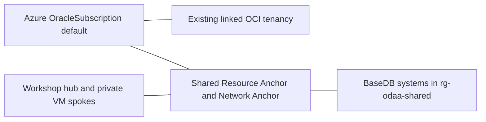

## Challenge 1: Understand the ODAA subscription

[Workshop overview](../../README.md)

> [!WARNING]
> **User2 is only an example.** Replace `mhuser2`, `vm-mhuser2`,
> `rg-vm-mhuser2` and `basedb2` with your own assigned user
> number and resource names. Tenant, subscriptions, shared networking and PDB
> `WORKSHOP` stay the same.

This challenge is read-only. The organizer has already completed Marketplace
onboarding and linked the existing OCI tenancy. Participants must not purchase
another offer, create another OCI account, unlink the tenancy or delete the
OracleSubscription.

## Current subscription boundaries

| Resource | Location |
|----------|----------|
| Tenant | `8fd3e0b6-0302-4084-a31f-1dfc5bbd03f5` |
| Hub, Bastion, firewall, resolver and seven private client VMs | Workshop subscription `aca3d6b0-497a-40cc-bdd0-e8e3ef6d8483` |
| OracleSubscription `default`, anchors, Oracle VNet and BaseDB systems | ODAA subscription `4ce5b5cc-e869-451f-98fc-f50448849ee0` |
| Shared Oracle resource group and replicated Azure private DNS zone | `rg-odaa-shared` in the ODAA subscription |

Only the ODAA subscription is approved for the workshop's Oracle Marketplace
integration. BaseDB resources must not be moved to the client subscription.
The linked OCI region is `eu-paris-1`; the Azure deployment region is
`francecentral`. These identifiers describe different control planes.

## Inspect readiness

After [account setup](../setup-user-account/setup-user-account.md), inspect the
existing integration in the Azure portal:

1. Search for **Oracle AI Database@Azure** and open the service.
2. Open **Oracle subscriptions** and select `default` in subscription `odaa`
   (`4ce5b5cc-e869-451f-98fc-f50448849ee0`).
3. On **Overview**, open **JSON View**.
4. Under `properties`, inspect `provisioningState` and `cloudAccountState`.
   Do not change any settings.

Required states are:

* OracleSubscription provisioning: `Succeeded`
* Linked cloud account: `Available`

Provider registration, catalog availability, quota, regional capacity,
permissions and pricing are part of the organizer's preparation.

## Responsibility and permissions

The participant group can inspect the Oracle resources and required catalog
details. BaseDB management rights do not grant OCI networking administration.
The organizer maintains native DNS replication, the hub link and Oracle's
default network rules. Participants add their own client SQL ingress in the
separate [network security challenge](../configure-odaa-basedb-nsg/configure-odaa-basedb-nsg.md).

Before the workshop, the organizer must arrange browser-based OCI read access
for participants in the existing linked tenancy. Participants need to view
their DB system, its node networking details and its PDB connection details.
Azure BaseDB management permissions alone do not grant this OCI access.
Participants retrieve their own full hostname, private IP and PDB service
in the [DNS challenge](../verify-odaa-basedb-dns/verify-odaa-basedb-dns.md)
and the [Easy Connect challenge](../connect-odaa-basedb/connect-odaa-basedb.md);
the organizer does not supply these values.

Use the OCI Console in your browser. Do not copy OCI CLI credentials to
participant VMs or share organizer credentials. Participant access does not
include general administration of the shared OCI network. It permits security
rule changes on the tagged workshop NSG only.

The participant databases use Standard Edition, which is sufficient for the
workshop's networking and read-only SQL exercises.

## Success criteria

* You can distinguish Azure subscription, OracleSubscription and OCI tenancy.
* The readiness check confirms `Succeeded` / `Available`.
* You know which resources belong in each subscription.
* No purchase or onboarding mutation was performed.

Next: [Create a Base Database](../create-odaa-basedb/create-odaa-basedb.md).

## Organizer references

* [Oracle onboarding prerequisites](https://docs.oracle.com/en-us/iaas/Content/database-at-azure/oaaprerequisites.htm)
* [Link an existing OCI tenancy](https://docs.oracle.com/en-us/iaas/Content/database-at-azure/onboard-link.htm)
* [Independent organizer deployments](../../infra/deployments/README.md)
