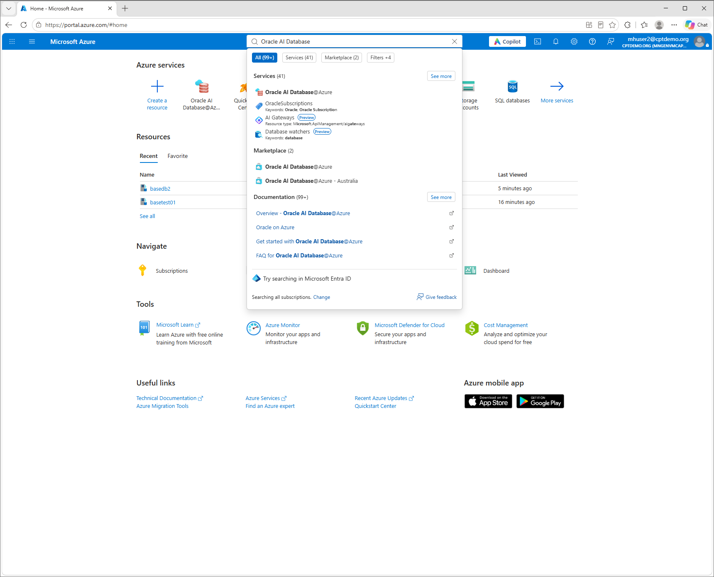

## Challenge 4: Verify private DNS

[Workshop overview](../../README.md)

> [!WARNING]
> **User2 is only an example.** Replace `mhuser2`, `vm-mhuser2`,
> `rg-vm-mhuser2` and `basedb2` with your own assigned user
> number and resource names. Tenant, subscriptions, shared networking and PDB
> `WORKSHOP` stay the same.

Run all VM commands in the browser-based Bastion session opened through the
Azure portal. Use `dig` for DNS resolution; no local terminal, Cloud Shell
or Azure CLI connection is needed.

After [adding your SQL ingress rule](../configure-odaa-basedb-nsg/configure-odaa-basedb-nsg.md),
inspect the database DNS path. You chose the hostname prefix during database
creation. In this challenge, find the full hostname and its private IP.
Keep both values for the next challenge, where you retrieve the PDB
connection string and sign in to the database.

## Private DNS path

```text
Client DNS: VM -> Firewall 10.100.0.4 -> Resolver inbound 10.100.0.132
              -> Oracle-replicated Azure private DNS zone
```

The hub, anchors, routes, replicated DNS zone and links are shared resources.
This participant challenge only inspects the DNS configuration and resolves
the database hostname. Do not change the shared resources.

## Step 1: Find your database FQDN in the Azure portal

1. Open the [Azure portal](https://portal.azure.com/) in a private browser window.
2. Sign in with your assigned workshop account, for example
   `mhuser2@cptdemo.org`, and complete MFA.
3. In the search bar, search for **Oracle AI Database@Azure** and open the service.

4. In the left menu, select **Oracle Base Database Service**. In the subscription
   filter, select `odaa` (`4ce5b5cc-e869-451f-98fc-f50448849ee0`).  

5. Open your BaseDB system from the list, for example `basedb2` for User2.

6. On **Overview**, select **JSON View**. Under `properties`, find `hostname`
   and `domain`. These are resource properties, not the database display name.


For User2, the relevant values look like this:

```json
{
  "hostname": "basedb2",
  "domain": "ocisnetodaadel.ocivnetodaasha.oraclevcn.com"
}
```

Join your resource's `hostname` and `domain` with a dot:

```text
<hostname>.<domain>
```

For the example above, the full database hostname (FQDN) is:

```text
basedb2.ocisnetodaadel.ocivnetodaasha.oraclevcn.com
```

### Connect to your VM through Bastion and test DNS

1. In the Azure portal search bar, search for **Virtual machines** and open
   the service.


2. Select your own VM, for example `vm-mhuser2` in `rg-vm-mhuser2`.


3. On **Overview**, check that the VM is **Running**. If it is stopped or
   deallocated, select **Start** and wait until it is running.


4. Select **Connect** > **Connect via Bastion**. Use the existing Bastion host
   `bas-workshop-hub`.


5. Under **Connection settings**, select **SSH**, port `22`, and
   **Microsoft Entra ID** as the **Authentication type**.


6. Select **Connect** and allow popups to open the Bastion session.


7. In the Bastion session, you should now have a shell prompt on your VM.


### Inside the Bastion session

The workshop group `mh-workshop-participants` has Reader access to the shared
Bastion resources. Each participant also has **Virtual Machine User Login**
on their own VM and access to that VM's network resources. You do not need a
local VM password, an SSH private key or Cloud Shell for this connection.

### Verify the VM hostname
In the **VM shell** in the Bastion tab, verify which VM you reached:

```bash
hostname
```


For User2, the result must be `vm-mhuser2`.

### Resolve the database FQDN

In the VM shell in the Bastion browser tab, save your database hostname
in `DB_HOST`. Replace the value inside the quotes with your hostname from
Step 1. This example is for User2. Do not add spaces around `=`.

```bash
DB_HOST='basedb2.ocisnetodaadel.ocivnetodaasha.oraclevcn.com'
```

Then check DNS:

```bash
dig "$DB_HOST" A +short +time=5 +tries=1
```


Expected: your Oracle BaseDB's private IPv4 address. This uses the VM's configured
DNS path, not DNS on your local computer. 

## Step 2: Follow the DNS path in the Azure portal

Start in the resource group where you deployed your BaseDB. This step is
read-only: inspect the existing settings without changing or saving them.

### Open the BaseDB resource group and DNS zone

1. In the portal search bar, search for **Resource groups** and open the service.


2. Select `rg-odaa-shared` in subscription `odaa`.


3. In the resource list, find the resource of type **Private DNS zone** whose
   name matches the `domain` from Step 1:
   `ocisnetodaadel.ocivnetodaasha.oraclevcn.com`.


4. Open that zone. Oracle replicates this zone and its database DNS records
   into Azure during provisioning.


5. Verify your hostname in the recordsets
The IP address listed in the recordsets should match the private IPv4 address you obtained from the DNS resolution step via Bastion.

The zone name is the domain part of your FQDN, without the database hostname.

### Follow the zone's VNet link to the hub

1. In the DNS zone menu, under **DNS Management**, select **Virtual network links**.


2. Find `link-workshop-hub`. Verify that its virtual network is
   `vnet-workshop-hub` and its link status is **Completed**.
   Auto-registration is **Disabled** because Oracle supplies the records.


3. Open the linked virtual network `vnet-workshop-hub`. It is in
   `rg-workshop-hub` in the workshop subscription
   (`aca3d6b0-497a-40cc-bdd0-e8e3ef6d8483`).


The link connects the private DNS zone to the **hub VNet**, not directly to
the resolver resource. This makes the zone available to the DNS resolver
located in that VNet.

## Success criteria

* `dig` returns the private IP recorded in the Azure DNS zone.
* You have saved your database's full hostname and private IP.
* You can follow the DNS path from the VM to the replicated private zone.

Next: [Retrieve the PDB connection string and connect](../connect-odaa-basedb/connect-odaa-basedb.md).
